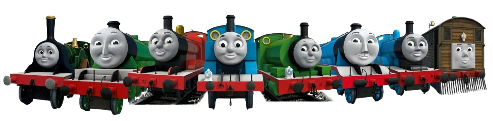
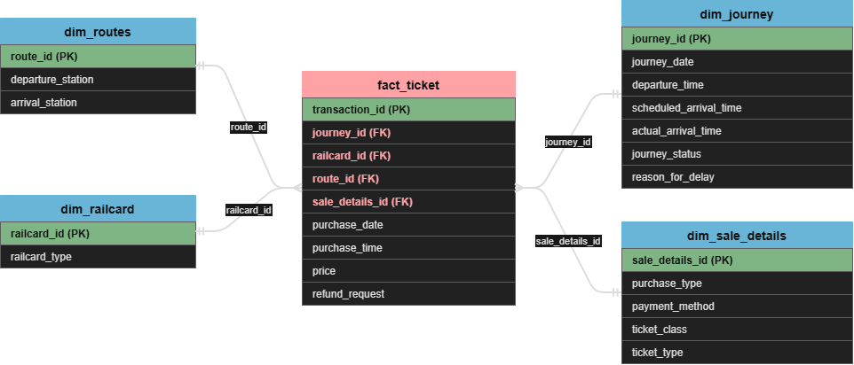

<p align="center">
  
  
  
  
</p>

# DEPI Graduation Project 
This graduation project is part of the DEPI Professional Data Analysis Track. Each team member is responsible for a specific technology or tool used throughout the project.
<div>
  <table>
    <tr>
      <th align="center">Name</th>
      <th align="center">Segment</th>
    </tr>
    <tr>
      <td align="center">Aly</td>
      <td align="center">Python 🐍</td>
    </tr>
    <tr>
      <td align="center">Mahitab</td>
      <td align="center">SQL 🗄️</td>
    </tr>
    <tr>
      <td align="center">Peter</td>
      <td align="center">Looker 📊</td>
    </tr>
    <tr>
      <td align="center">Sama</td>
      <td align="center">Tableau 📈</td>
    </tr>
    <tr>
      <td align="center">Shahd</td>
      <td align="center">Power BI 💡</td>
    </tr>
  </table>
</div>

## Star Schema


## Project Structure

```
UK-Train-Rides-project/
├── data/
│   ├── cleaned/
│   ├── raw/
│   │   └── railway.csv
│   └── star/
│       ├── dim_journey.csv
│       ├── dim_railcard.csv
│       ├── dim_routes.csv
│       ├── dim_sale_details.csv
│       └── fact_ticket.csv
├── docs/
│   ├── diagrams/
│   │   └── star_schema.drawio
│   ├── images/
│   │   ├── analysis.gif
│   │   ├── star_schema.png
│   │   └── thomas.png
│   ├── Normalization & Star Schema.docx
│   └── Project Planning.docx
├── notebooks/
│   └── main.ipynb
├── src/
│   ├── __init__.py
│   └── plotting.py
├── .gitignore
├── README.md
└── requirements.txt
```
